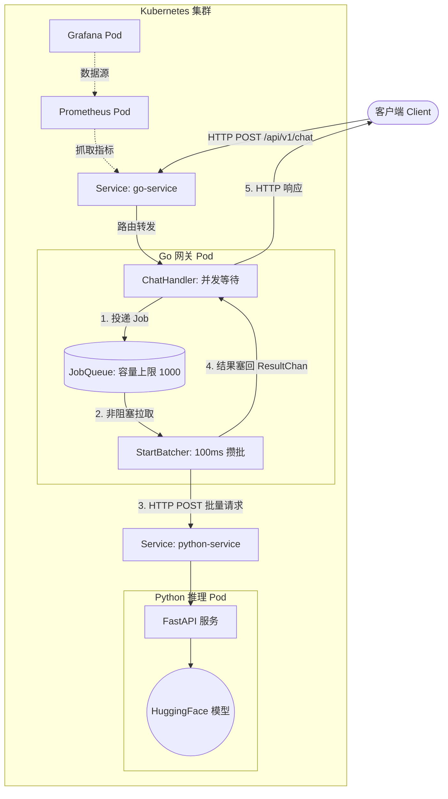

# AI Inference Gateway

[](https://github.com/dtr222222/ai-inference-gateway/actions/workflows/ci.yml)
[](https://go.dev/)
[](https://www.python.org/)
[](https://kubernetes.io/)
[](https://prometheus.io/)

基于 Go (Gin) 与 Python (FastAPI) 的**纯血云原生**异构大模型推理网关。内置**动态批处理（Dynamic Batching）**、**请求取消传播**、**全链路分布式追踪**与**细粒度可观测性**，为底层脆弱的 LLM 服务提供企业级的流量调度与安全兜底。

## 📖 目录

- [核心特性](#-核心特性)
- [系统架构](#-系统架构)
- [性能压测与收益](#-性能压测与收益报告)
- [云原生部署指南](#-云原生部署指南)
- [API 文档](#-api-文档)
- [工程设计亮点](#-工程设计亮点)

---

## ✨ 核心特性

- **异构微服务架构**：Go 作为高并发控制面（网关），Python 作为纯数据面（模型推理），通过 K8s Service 高效通信。
- **动态批处理 (Dynamic Batching)**：网关在内存中维护请求队列，以 `100ms` 为时间窗口，将并发请求打包成 Batch（单批上限 50）一次性发送给模型，大幅提升后端吞吐量，防止模型 OOM。
- **全链路分布式追踪**：基于 UUID 实现跨语言追踪。Go 网关生成 `Request-ID`，随批量请求透传至 Python，并在结果返回时进行**严格的反向 ID 对账**，确保结果零错乱。
- **请求取消与级联传播**：基于 `context` 实现。客户端断开连接时，取消信号瞬间穿透网关层，阻止废弃任务发往模型，极致节省算力。
- **全云原生部署**：全面抛弃 Docker Compose，基于 Kubernetes 编排所有微服务。使用 `ConfigMap` 管理配置，`PVC` 持久化数据，`Service` 实现服务发现。
- **细粒度可观测性**：集成 Prometheus 与 Grafana，监控网关 QPS、延迟分布（P95/P99）、当前排队积压数、批处理大小，以及细粒度的 `job_outcome`（delivered / timeout / cancelled / orphaned）。

---

## 🏗️ 系统架构



---

## 📊 性能压测与收益报告

为了验证网关在高并发场景下的价值，我们使用 `hey` 压测工具，对比了**“裸奔直连模型端”**与**“经过动态批处理网关”**的性能差异。

**测试条件**：本地 Docker 环境，CPU 运行 `tiny-gpt2` 模型，50 并发，总计 300 个请求。

| 核心指标 | 裸奔直连模型端 (无批处理) | 经 AI 网关转发 (动态批处理) | 性能提升 |
| :--- | :--- | :--- | :--- |
| **吞吐量 (QPS)** | 4.3 | **8.33** | **提升 93%** |
| **平均延迟 (Average)** | 10.75 秒 | **6.00 秒** | **降低 44%** |
| **P99 延迟 (长尾体验)** | 19.42 秒 (并伴随超时) | **7.01 秒** | **长尾极其稳定** |
| **成功率** | 96.7% (10 个超时报错) | **100%** (300/300) | **零错误** |

> **为什么加了网关，延迟反而更低？**
> 在直连模式下，50 个并发请求会瞬间撑爆 FastAPI 的线程池，大量时间浪费在操作系统的线程切换与 CPU 抢占上。引入 Go 网关后，Batcher 引擎利用 `100ms` 的时间窗口将并发请求合并为 Batch 发送。底层的 PyTorch 利用矩阵运算一次性处理多个 Prompt，极大减少了上下文切换开销，真正实现了“削峰填谷”。

---

## 🚀 云原生部署指南

### 前置要求
- 安装并启动 Docker Desktop
- 启用 Docker Desktop 自带的 Kubernetes 集群 (Settings -> Kubernetes -> Enable Kubernetes)
- 确保本地已构建 Go 和 Python 的 Docker 镜像（参考各目录下的 `Dockerfile`）

### 一键部署

```bash
# 克隆项目
git clone https://github.com/your-username/ai-inference-gateway.git
cd ai-inference-gateway

# 应用所有 K8s 资源清单 (Deployment, Service, ConfigMap, PVC)
kubectl apply -f k8s-manifests/
```

### 验证状态
```bash
kubectl get pods,svc,pvc
```
服务启动后，各组件的访问地址如下：
- **Go 网关 API**: `http://localhost:8080` (通过 LoadBalancer 暴露)
- **Prometheus 面板**: `http://localhost:9090`
- **Grafana 监控大屏**: `http://localhost:3000` (账号/密码: `admin`)

---

## 📡 API 文档

### 发起推理请求

**POST** `/api/v1/chat`

**Request Body:**
```json
{
  "prompt": "Hello, I am a Go developer"
}
```

**Response (200 OK):**
```json
{
  "reply": "Hello, I am a Go developer and I am working on an AI gateway..."
}
```

**错误响应:**
- `400 Bad Request`: 请求 JSON 格式错误。
- `499 Client Closed Request`: 客户端主动断开连接。
- `502 Bad Gateway`: 下游模型服务异常或跨语言 ID 对账失败。
- `504 Gateway Timeout`: 模型处理超时（触发网关熔断）。

---

## 🧠 工程设计亮点

1. **为什么使用动态批处理？**
   直接对模型发起并发请求会导致极高的上下文切换开销。本项目在 Go 网关层利用 `select` 和 `time.Ticker` 实现了非阻塞的攒批引擎，每 `100ms` 将排队的请求拼装成数组发送给 Python，大幅提升吞吐。
2. **跨语言链路的“反向对账”**
   在 `processBatch` 中实现了严格的 `RequestID` 校验。若 Python 返回的 ID 与 Go 侧的 ID 不匹配，网关会抛弃该结果，并以 `502` 快速失败，杜绝脏数据返给用户。
3. **取消传播（Cancellation Propagation）**
   客户端关闭网页时，网关会拦截已取消的请求，阻止其发往模型。若模型已算完，网关也会检测其 Context，将结果标记为 `orphaned` 丢弃，极致节省 GPU/CPU 算力。
4. **K8s 环境下的优雅停机**
   K8s 销毁 Pod 时发送 `SIGTERM`。网关捕获信号后，先切断新流量；随后给后台的 `StartBatcher` 派发最后一次“抢救任务”，并利用独立的 Context 预算等待其处理完毕，最后安全退出。

---

## 📄 License

[MIT](https://choosealicense.com/licenses/mit/)