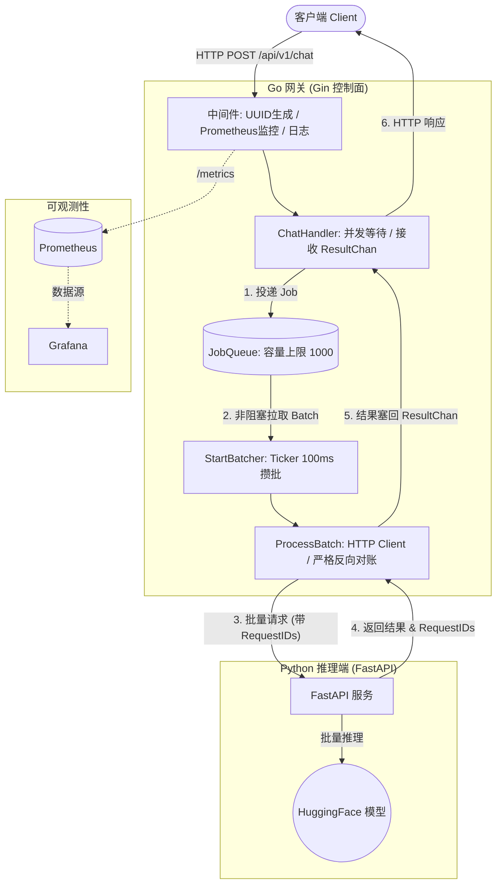

# AI Inference Gateway

[](https://go.dev/)
[](https://www.python.org/)
[](https://www.docker.com/)
[](https://prometheus.io/)

基于 Go (Gin) 与 Python (FastAPI) 的高性能异构大模型推理网关。内置**动态批处理（Dynamic Batching）**、**请求取消传播**、**全链路分布式追踪**与**细粒度可观测性**，为底层脆弱的 LLM 服务提供企业级的流量调度与安全兜底。

## 📖 目录

- [核心特性](#-核心特性)
- [系统架构](#-系统架构)
- [快速开始](#-快速开始)
- [API 文档](#-api-文档)
- [工程设计亮点](#-工程设计亮点)

---

## ✨ 核心特性

- **异构微服务架构**：Go 作为高并发控制面（网关），Python 作为纯数据面（模型推理），通过内部 HTTP 网络高效通信。
- **动态批处理 (Dynamic Batching)**：网关在内存中维护请求队列，以 `100ms` 为时间窗口，将并发请求打包成 Batch（单批上限 50）一次性发送给模型，大幅提升后端吞吐量，防止模型 OOM。
- **全链路分布式追踪**：基于 UUID 实现跨语言追踪。Go 网关生成 `Request-ID`，随批量请求透传至 Python，并在结果返回时进行**严格的反向 ID 对账**，确保结果零错乱。
- **请求取消与级联传播**：基于 `context` 实现。当客户端断开连接时，取消信号会瞬间穿透网关层，阻止已排队的废弃任务发往模型，有效避免算力浪费。
- **高可用与优雅停机**：结合 `signal.NotifyContext` 监听 `SIGTERM`，在 K8s 滚动更新时，先切断新流量，再独立分配超时预算给 HTTP 服务与后台批处理队列，确保内存中的任务安全落地（Zero Data Loss）。
- **细粒度可观测性**：集成 Prometheus 与 Grafana，监控网关 QPS、延迟分布（P95/P99）、当前排队积压数、批处理大小，以及细粒度的 `job_outcome`（delivered / timeout / cancelled / orphaned / failed）。

---

## 🏗️ 系统架构



---

## 🚀 快速开始

### 前置要求
- Docker 与 Docker Compose (至少分配 4GB 内存)

### 一键启动

```bash
# 克隆项目
git clone https://github.com/your-username/ai-inference-gateway.git
cd ai-inference-gateway

# 后台构建并启动所有服务
docker compose up -d --build
```

启动后，各组件访问地址：
- **Go 网关 API**: `http://localhost:8080`
- **Prometheus 面板**: `http://localhost:9090`
- **Grafana 监控大屏**: `http://localhost:3000` (账号/密码: `admin`)

---

## 📡 API 文档

### 发起推理请求

**POST** `/api/v1/chat`

**Request Body:**
```json
{
  "prompt": "Hello, I am a Go developer"
}
```

**Response (200 OK):**
```json
{
  "reply": "Hello, I am a Go developer and I am working on an AI gateway..."
}
```

**错误响应:**
- `400 Bad Request`: 请求 JSON 格式错误或客户端主动断开。
- `502 Bad Gateway`: 下游模型服务异常或跨语言 ID 对账失败。
- `504 Gateway Timeout`: 模型处理超时（触发网关熔断）。

---

## 🧠 工程设计亮点（面试核心）

### 1. 为什么使用动态批处理？
直接对模型发起并发请求会导致极高的上下文切换开销和显存/CPU 碎片化。本项目在 Go 网关层利用 `select` 和 `time.Ticker` 实现了非阻塞的攒批引擎。每 `100ms` 将排队的请求拼装成数组发送给 Python，利用 FastAPI 的矩阵运算能力大幅提升吞吐。

### 2. 跨语言链路的“反向对账”
因为模型是批量处理的，一旦网络乱序或模型返回漏包，结果就会张冠李戴。本项目在 `processBatch` 中实现了严格的 `RequestID` 校验。若 Python 返回的 ID 与 Go 侧的 ID 不匹配，网关会抛弃该结果，并以 `502` 快速失败，杜绝脏数据返给用户。

### 3. 取消传播（Cancellation Propagation）
如果用户在等待期间关闭了网页，Go 网关的 `c.Request.Context().Done()` 会被触发。系统会在将任务打包发给模型前进行拦截（过滤掉已取消的请求）。如果模型已经算完，网关也会检测其 Context，直接将结果标记为 `orphaned` 丢弃，极致节省 GPU/CPU 算力。

### 4. 优雅停机设计
K8s 销毁 Pod 时发送 `SIGTERM`。网关捕获信号后，首先执行 `srv.Shutdown` 切断新流量；随后给后台的 `StartBatcher` 派发最后一次“抢救任务”，并利用独立的 Context 预算（独立于 HTTP 超时）等待其处理完毕，最后安全关闭数据库连接池。

---

## 📄 License

[MIT](https://choosealicense.com/licenses/mit/)