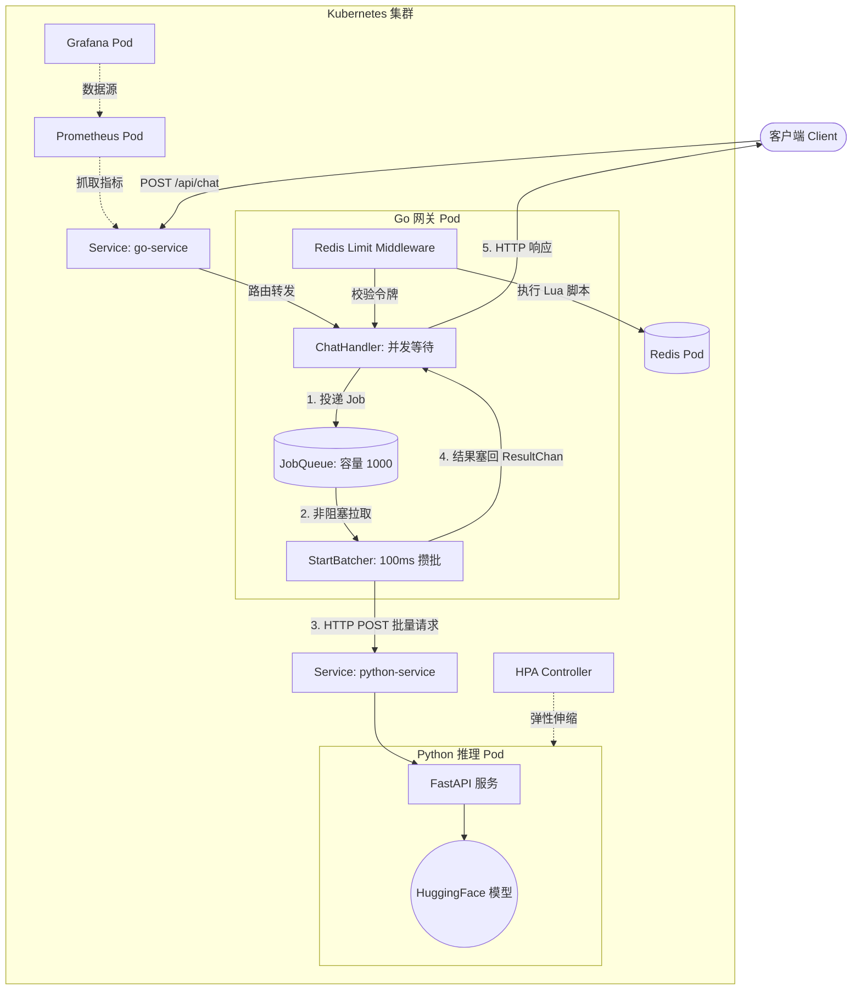

# AI Inference Gateway

[](https://github.com/dtr222222/ai-inference-gateway/actions/workflows/ci.yml)
[](https://go.dev/)
[](https://www.python.org/)
[](https://kubernetes.io/)
[](https://redis.io/)

基于 Go (Gin) 与 Python (FastAPI) 构建的**异构大模型推理网关**。本项目采用纯云原生架构，内置**动态批处理**、**分布式令牌桶限流**、**全链路分布式追踪**与**细粒度可观测性**。为底层脆弱的 LLM 服务提供企业级的流量调度与安全兜底。

## 📖 目录
- [核心特性](#-核心特性)
- [系统架构](#-系统架构)
- [性能压测与收益](#-性能压测与收益)
- [云原生部署指南](#-云原生部署指南)
- [API 文档](#-api-文档)
- [工程设计亮点](#-工程设计亮点)

---

## ✨ 核心特性

- **异构微服务架构**：Go 作为高并发控制面（网关），Python 作为纯数据面（模型推理），通过 K8s Service 高效通信。
- **动态批处理 (Dynamic Batching)**：网关以 `100ms` 为时间窗口，将并发请求打包成 Batch（单批上限 50）发送给模型，大幅提升后端吞吐量，防止模型 OOM。
- **分布式令牌桶限流**：基于 Redis + Lua 脚本实现原子性的令牌桶算法。支持突发流量控制，并在 Redis 故障时执行 Fail-Open 降级策略，防止系统雪崩。
- **K8s 弹性伸缩 (HPA)**：基于 CPU 指标动态扩缩容 Python 推理节点；通过优雅停机（Graceful Shutdown）与健康探针（Probes）实现滚动更新零中断。
- **全链路分布式追踪**：基于 UUID 实现跨语言追踪。Go 网关生成 `Request-ID` 透传至 Python，结果返回时进行**严格的反向 ID 对账**，确保结果零错乱。
- **细粒度可观测性**：集成 Prometheus 与 Grafana，监控网关 QPS、延迟、排队积压数、批处理大小，以及 `job_outcome`（delivered/timeout/cancelled/orphaned）。

---

## 🏗️ 系统架构



---

## 📊 性能压测与收益

为了验证网关架构的有效性，我们使用 `hey` 压测工具进行了对比测试（本地 Docker 环境，50 并发，总计 300 个请求）。

| 架构演进阶段 | 配置参数 | 成功响应 (200) | 被拦截/超时 (429/504) | 平均延迟 (Avg) | 网关 QPS | 核心评价 |
| :--- | :--- | :--- | :--- | :--- | :--- | :--- |
| **1. 裸奔直连模型** | 无网关保护 | 290 | 10 (504超时) | 10.75s | 4.3 | 模型被打爆，长尾延迟极高 |
| **2. 仅开动态批处理** | 无流量控制 | 300 | 0 | 6.00s | 8.33 | 吞吐翻倍，长尾稳定，但流量无上限 |
| **3. 开启 Redis 令牌桶 (严控)** | Vol=10, Rate=1 | 9 | **291 (429)** | **0.035s** | **252.7** | **限流器瞬间拦截 97% 流量，网关极速响应，绝对保护后端** |
| **4. 开启 Redis 令牌桶 (放宽)** | Vol=50, Rate=20 | 296 | 4 (429) | 6.90s | 7.14 | 阈值放宽后，绝大部分流量放行，系统进入平稳排队处理 |

> **结论**：
> 1. 对比阶段 1 与 2，动态批处理将模型吞吐量提升近 1 倍，并消除了超时错误。
> 2. 对比阶段 3 与 4，展示了限流器参数对系统的决定性影响。在严格限流下（阶段 3），网关能在 3 毫秒内拦截 97% 的突发流量，将 QPS 拉高到 252，避免后端被击穿；在放宽限流下（阶段 4），大量请求被放行，系统平稳排队，延迟回归到 6.9 秒。**这证明了 Redis 令牌桶在保护后端算力上的巨大价值。**

---

## 🚀 云原生部署指南

### 前置要求
- 安装并启动 Docker Desktop（开启自带的 Kubernetes 集群）。
- 已安装 `kubectl` 命令行工具。

### 一键部署

```bash
# 克隆项目
git clone https://github.com/你的用户名/ai-inference-gateway.git
cd ai-inference-gateway

# 应用所有 K8s 资源清单 (Deployment, Service, ConfigMap, PVC, HPA)
kubectl apply -f k8s-manifests/
```

### 验证状态
```bash
kubectl get pods,svc,hpa
```
服务启动后，各组件的访问地址如下：
- **Go 网关 API**: `http://localhost:8080`
- **Prometheus 面板**: `http://localhost:9090`
- **Grafana 监控大屏**: `http://localhost:3000` (账号/密码: `admin`)

---

## 📡 API 文档

### 发起推理请求
**POST** `/api/chat`

**Request Body:**
```json
{
  "prompt": "Hello, I am a Go developer"
}
```

**Response (200 OK):**
```json
{
  "reply": "Hello, I am a Go developer and I am working on an AI gateway..."
}
```

**错误响应:**
- `400 Bad Request`: 请求 JSON 格式错误。
- `429 Too Many Requests`: 触发分布式限流，请求被拒绝。
- `502 Bad Gateway`: 下游模型服务异常或跨语言 ID 对账失败。
- `504 Gateway Timeout`: 模型处理超时（触发网关熔断）。

---

## 🧠 工程设计亮点

### 1. 为什么使用动态批处理？
直接对模型发起并发请求会导致极高的上下文切换开销。本项目在 Go 网关层利用 `select` 和 `time.Ticker` 实现了非阻塞的攒批引擎，每 `100ms` 将排队的请求拼装成数组发送给 Python，大幅提升吞吐。

### 2. Redis + Lua 令牌桶限流的原子性
利用 Redis 单线程执行 Lua 脚本的原子性，完美解决了 `INCR` 和 `EXPIRE` 分离执行的并发竞态问题。采用惰性生成令牌算法，通过计算时间差动态补充令牌，实现削峰填谷。
*降级策略*：当 Redis 故障时，触发 200ms 超时并执行 `Fail-Open` 策略，防止因限流器崩溃导致网关整体不可用。

### 3. 跨语言链路的“反向对账”
模型采用批量处理。为了防止网络乱序或模型漏包，网关在结果分发前进行严格的 `RequestID` 校验。若 Python 返回的 ID 与 Go 侧的 ID 不匹配，网关直接抛弃结果，以 `502` 快速失败，杜绝脏数据返给用户。

### 4. K8s 环境下的零中断发布
*   **Probes**：使用 `startupProbe` 给 Python 模型加载留足时间；使用 `readinessProbe` 避免新 Pod 未就绪时分配流量。
*   **Graceful Shutdown**：收到 `SIGTERM` 后，网关通过 `atomic.Bool` 拦截并 503 拒绝新请求，`Sleep` 5 秒等待 K8s 路由表更新，最后安全释放所有 HTTP 与 Redis 连接。

---

## 📄 License
[MIT](https://choosealicense.com/licenses/mit/)