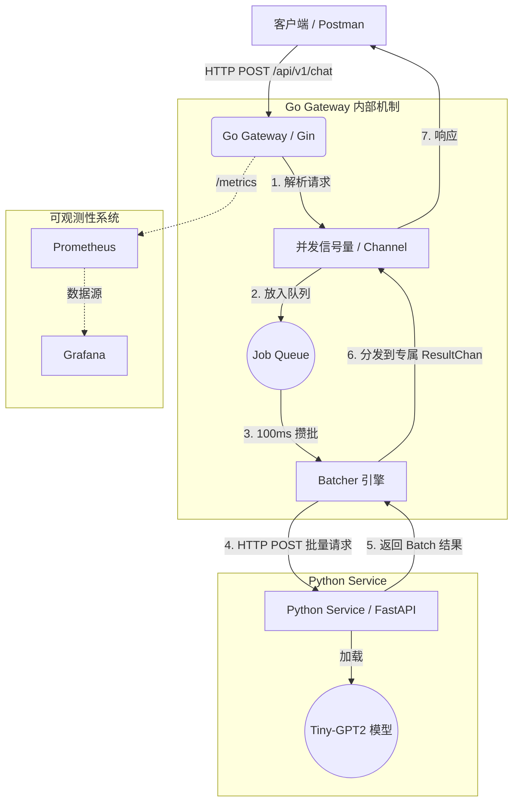

# AI Inference Gateway

[](https://go.dev/)
[](https://www.python.org/)
[](https://www.docker.com/)
[](https://prometheus.io/)

一个基于 Go (Gin) 与 Python (FastAPI) 的**异构大模型推理网关**。通过高并发控制、动态批处理（Dynamic Batching）与全链路可观测性，为底层脆弱的 LLM 模型提供企业级的流量调度与保护。

## 📖 目录

- [核心特性](#-核心特性)
- [系统架构](#-系统架构)
- [技术栈](#-技术栈)
- [快速开始](#-快速开始)
- [API 文档](#-api-文档)
- [工程设计亮点](#-工程设计亮点)

---

## ✨ 核心特性

- **异构微服务架构**：Go 作为高并发控制面（网关），Python 作为纯数据面（模型推理），通过 HTTP 内部网络高效通信。
- **动态批处理 (Dynamic Batching)**：网关在内存中维护请求队列，以 `100ms` 为时间窗口，将并发请求打包成 Batch 一次性发送给模型，大幅提升后端吞吐量。
- **并发保护与排队**：利用带缓冲的 Channel 实现信号量，防止海量请求瞬间压垮模型；基于 `context` 实现精确的排队超时与客户端断连感知。
- **全链路可观测性**：集成 `Prometheus` 与 `Grafana`，实时监控网关 QPS、请求延迟分布（P95/P99）、当前排队积压数及批处理大小分布。
- **优雅启停**：结合 `signal.NotifyContext` 与 `http.Server.Shutdown`，确保滚动更新时不丢失任何正在处理的请求。
- **容器化编排**：基于 Docker Compose 一键拉起 Go 网关、Python 模型、MySQL、Prometheus、Grafana 五件套。

---

## 🏗️ 系统架构



---

## 💻 技术栈

- **控制面 (Control Plane)**：Go, Gin, Go Channels, Context, `log/slog`
- **数据面 (Data Plane)**：Python, FastAPI, HuggingFace `transformers`, PyTorch
- **基础设施 (Infrastructure)**：Docker, Docker Compose, MySQL (GORM)
- **可观测性 (Observability)**：Prometheus (client_golang), Grafana

---

## 🚀 快速开始

### 前置要求
- 已安装 Docker 与 Docker Compose
- 至少 4GB 可用内存（由于包含 PyTorch 模型与监控组件）

### 一键启动

```bash
# 克隆项目
git clone https://github.com/your-username/ai-inference-gateway.git
cd ai-inference-gateway

# 启动所有微服务（后台运行）
docker compose up -d --build
```

服务启动后，各组件的访问地址如下：
- **Go 网关 API**: `http://localhost:8080`
- **Python 模型服务 (内部)**: `http://python_service:8000`
- **Prometheus 面板**: `http://localhost:9090`
- **Grafana 监控大屏**: `http://localhost:3000` (账号/密码: `admin`)

---

## 📡 API 文档

### 发起推理请求

**POST** `/api/v1/chat`

**Request Body:**
```json
{
  "prompt": "Hello, I am a Go developer"
}
```

**Response (200 OK):**
```json
{
  "reply": "Hello, I am a Go developer. I am currently working on..."
}
```

**错误响应:**
- `400 Bad Request`: 请求 JSON 格式错误。
- `429 Too Many Requests`: 网关排队已满，请求被拒绝（触发限流）。
- `502 Bad Gateway`: Python 模型服务不可用。
- `504 Gateway Timeout`: 模型处理超时。

---

## 🧠 工程设计亮点

### 1. 为什么使用动态批处理 (Dynamic Batching)？
直接对模型发起并发请求会导致极高的上下文切换开销和显存/CPU 碎片化。本系统在 Go 网关引入了 `Batcher` 引擎：
- 利用 `time.Ticker` 每 `100ms` 触发一次。
- 收集这段时间内 `JobQueue` 里的所有请求，将 `[]string` 打包成一个矩阵。
- Python 端的 HuggingFace `pipeline` 原生支持数组输入，利用 CPU/GPU 的并行计算能力，将原本需要 N 次的推理合并为 1 次，**大幅提升了系统的吞吐上限**。

### 2. 并发控制与防雪崩
- **排队机制**：网关通过带缓冲的 Channel 保护后端，若 `JobQueue` 达到上限，或者请求在队列中等待超时（`select` + `time.After`），直接返回 `429`，防止无限排队耗尽服务器内存。
- **上下文级联取消**：如果客户端在等待期间断开连接（`c.Request.Context().Done()`），网关会立即释放该请求占用的资源，并停止后续的模型调用。

### 3. 可观测性大屏
在 Grafana 中，可以直观地看到以下核心指标：
- `http_requests_total`: 接口 QPS 与错误率趋势。
- `http_request_duration_seconds`: P95/P99 响应延迟。
- `batch_queue_size`: 网关内部积压的请求数（反映系统拥堵情况）。
- `batch_size`: 每次批处理的请求数量分布。

---

## 📄 License

[MIT](https://choosealicense.com/licenses/mit/)